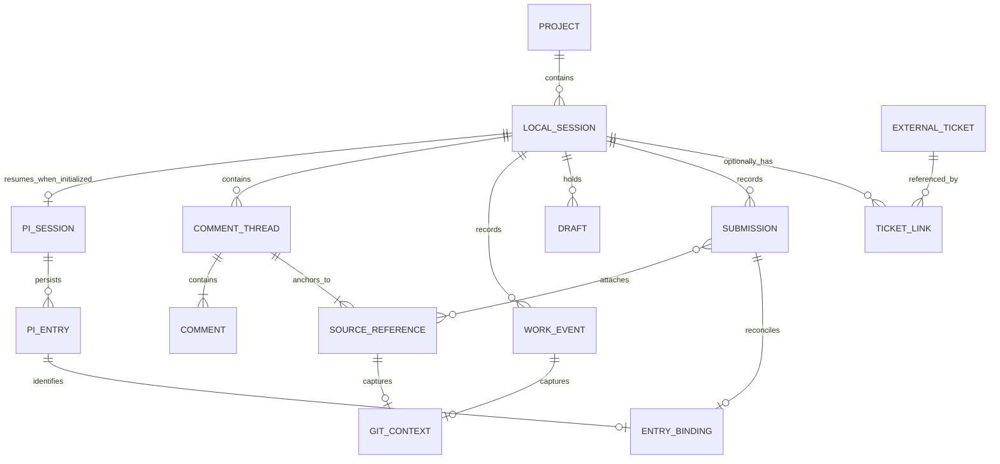

# Tim Data Model

Related: [[Tim/Tim Overview]] · [[Tim/Tim Session Flow]]

This is a logical model for Tim. It does not assert the current TicketBunker
database schema or commit Tim to a database engine.

## Relationships

`PI_SESSION` means the persisted conversation, not its running process. The
one-to-one session mapping applies after agent initialization; local comments and
drafts work before Pi starts. Starting or stopping Pi does not create or destroy
the local session. `ENTRY_BINDING` connects a submission to
its accepted Pi user-message entry. Replies follow Pi's entry ancestry; a turn
may contain several messages and tool calls. An unbound submission is not proof
that Pi rejected it.

`EXTERNAL_TICKET` is an external identity, not a local replica of a ticket row.
Each link identifies the TicketBunker instance/bunker and ticket, allowing many
sessions to reference a ticket and a session to reference several tickets.

`GIT_CONTEXT` is the observed repository, worktree, ref/name, HEAD, and dirty state
when a record was captured. Every session records it when Git is available, without
being bound to a branch. This is separate from Pi's conversation-tree branch.
The repeated `GIT_CONTEXT` relationships describe embedded snapshots, not a shared
mutable row whose changes would rewrite historical provenance.

Threads and comments have stable IDs, explicit author roles and timestamps. Human
notes live in Tim; assistant replies link to Pi entries as their authoritative
text source. `WORK_EVENT` distinguishes human source saves from explicitly applied
agent suggestions, recording saved-content hashes separately from HEAD.

## Current buffer and exact selection

`requests[].current_file` is the complete buffer captured at send time, including
saved/unsaved state, hash and Git provenance. History export retains this field.
Files above 256 KB are rejected before sending rather than truncated; the total
prompt cap is 400 KB. Earlier selection snapshots remain separate from the fresh
current-file snapshot, so they cannot silently replace new buffer content.

Source references optionally carry `selection_text`, `column_start` and
`column_end`. Columns are one-based UTF-8 byte positions, with an exclusive end.
The existing whole-line `text` snapshot remains the relocation anchor; the new
fields specify exact focus and preserve compatibility with line-based readers.
Unsent input still uses the internal `draft` record, saved automatically without
exposing a draft-management workflow to the user.

## Review and structured editor actions

The shared input stores intent=review|chat and selected references. Requests keep
scope, focus_references, full current_file, and originating Git metadata. Blank
Review input becomes a visible default instruction. There is no separate review
draft or popup. Cancelling Review preserves text; Enter always invokes Pi.

Successful editor_comment/editor_propose_diff toolResult entries carry
versioned details.tim data with a matching toolCallId. Findings use stable IDs;
refreshes update the same comment_id. Proposals link that ID directly. Tim keeps
anchors, request/thread identity and local resolved state in state.annotations.
The active Pi branch supplies the records; old prose annotations/diffs remain
supported. Source anchors become outdated when relocation cannot be verified.

A temporary diff preview contains buffer base/output and changedticks. Explicit
Apply validates all targets and changes buffers only. proposal_applied records
proposal_id, entry ID, actor=user, Git context, paths and before/after snapshots.
proposal_rejected and proposal_undone record further user decisions. Undo checks
all application outputs against current buffers before changing anything. Saved
source events remain separate. These records survive restart and are exported.
Exported conversation records also retain editor_action payloads so pending
structured diffs are not reduced to titles in downstream indexes.

## Sources of truth

| Record | Owner | Tim's treatment |
| --- | --- | --- |
| Project identity and root/worktree association | Tim | Persist a stable local ID; retain the root as a location |
| Local session ID, project-unique name, last-used timestamp, and exact Pi session identity/path | Tim | Persist and explicitly resume |
| Conversation entries and ancestry | Pi | Read through RPC; use stable entry IDs |
| Draft text and submission intent | Tim | Save before sending; retain on failure |
| Line comments and thread anchors | Tim | Persist local notes and reference Pi entries for agent replies |
| Per-record Git context and per-branch recent usage | Tim | Observed provenance, with no session binding |
| Source-save and suggestion-application events | Tim | Distinct event kinds with explicit author role and saved-content hash |
| Attached source excerpt, path, range, hash/revision | Tim | Preserve the submitted snapshot, including unsaved text |
| Current source contents | Filesystem and Neovim buffers | Keep live contents distinct from historical snapshots |
| File/time lookup index | Tim | Derived; rebuild from Pi entries and Tim metadata |
| Ticket content and status | TicketBunker | Read via its supported interface; label cached data if later added |
| Optional ticket association | Tim | Persist external IDs without owning the ticket |

Lookup dimensions are repository, exact relative path, line/range, Git context,
session/thread/message ID, author, and timestamp. Explicit TicketBunker repository
bindings and optional ticket links add integration dimensions. Do not merge same-
named files or branches across repositories. See [[Tim/Tim TicketBunker Compatibility]].

## Initial storage

Use Pi's native persistent session and separate local Tim metadata/drafts under
the user's application-data directory. The implementation uses versioned
`state.json` with atomic replacement alongside Pi's `pi.jsonl`. Decide on SQLite only
if indexing, transactions, or concurrency needs justify it; no database engine is
selected here.

Pi and Tim do not share an atomic transaction. Record submission intent before
sending, bind it to the resulting Pi entry after acceptance, and reconcile on
restart. Request IDs correlate RPC responses; do not assume they provide durable
deduplication or appear on all stream events.

## Invariants

- `tim -s <name>` opens or creates a session in the current project. Plain `tim`
  resumes that project's saved default, prompting for a name if none is selected.
- Update `last_used_at` on successful open/resume and accepted user submissions;
  break timestamp ties by stable session ID. Names are labels, not storage paths.
- Opening Tim or starting a local session never requires a ticket ID.
- `--branch` filters session selection by observed usage without modifying Git.
- File navigation, comments, saves, and contextual retrieval never trigger Pi.
- The current context pane matches exact file paths and labels other sessions and
  Git branches. Ranking by overlap/relevance remains a future enhancement.
- Ticket closure, deletion, or unavailability does not erase local history.
- File filtering changes presentation, not Pi's context or session identity.
- A single active writer owns each session in the initial implementation.
- Pi's full entry history supplies old exchanges after compaction; the rendered
  default transcript follows the active branch rather than mixing alternatives.
- Source links retain captured text and report ambiguous relocation after edits.
- Tim never writes directly into TicketBunker's database.
- Rebuilding indexes never sends prompts or executes agent tools.

## Questions for the TicketBunker audit

These are integration questions, not findings about defects:

1. Which stable instance, project, and ticket identifiers can clients retain?
2. Which supported interface reads context and applies explicit task updates?
3. Can the existing Pi activity extension attach to a session that began outside
   a ticket workflow, and how should it record that association?
4. What deduplication and conflict behavior exists for retried external updates?
5. Which records are authoritative versus cached or derived in TicketBunker?

The answers should shape the optional adapter without making Tim depend on a
ticket's lifecycle.

## Comment-linked proposals

New proposals are typed tool results linked by comment_id. Legacy fenced diffs
use file/hunk overlap and captured snapshots. Both appear in the same Diffs view.
Approval state derives from work events; old approvals without proposal_id cover
their proposal_entry. Applying one structured proposal never approves siblings.
