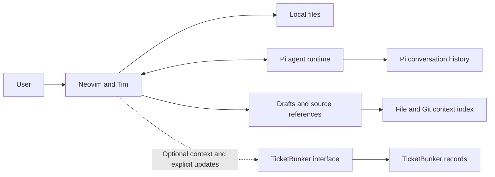

# Tim

Tim is a portable Neovim editor for working with a local agent session. It is
the editing companion to TicketBunker, useful both with and without it.

Confirmed direction: Neovim only, Lua with a small shell launcher, Pi as the agent,
line comments, file-linked questions and replies, contextual history, and optional
automatic Git context. The first implementation now lives in the Bunker workspace:
Lua plugin, shell launcher, local persistence, comments, Pi RPC, history import,
and index export. Broader integration and packaging remain proposals.

The person is the primary worker. Keep source code in the main pane and a compact
agent/context view alongside it. The agent helps explain, review, and suggest;
it does not start working merely because a file opens or a comment is saved.

## The boundary

A session belongs to the user's ongoing local work. It can investigate a question,
develop a feature, span several tickets, or have no ticket at all. Completing a
ticket does not end the session. Attaching a ticket does not create another agent.



## What each part owns

| Part | Responsibility |
| --- | --- |
| Neovim | Editing, navigation, buffers, and windows |
| Tim | Session selection, line comments, drafts, file references, history and Git context indexes |
| Pi | Agent execution, model context, compaction, and conversation history |
| TicketBunker | Its work records and their lifecycle, accessed through its interface |

Tim should not maintain a competing copy of TicketBunker's database or Pi's
conversation store. A file-filtered session is a view, not another conversation.

## Delivery

```sh
tim                         # Resume the saved default session
tim -s parser               # Choose parser as the default session
tim -s "database redesign"  # Quoted names can contain spaces
tim -s parser               # Git context is captured automatically
tim --branch                # Latest session used on the current branch
```

Defaults are saved per folder/Git worktree. If none is selected, ask for a name.
`tim filename` opens that file alongside the default session. A session name is a label
mapped to a stable ID; it is not a path or ticket identifier.

`--branch` only filters session selection. Git context is captured on every
record without a flag. Sessions can span branches and never require a ticket.

First implementation: Lua inside Neovim, directly connected to Pi RPC.
A `tim` launcher opens an isolated, bundled Neovim configuration. The same Lua
modules can also be installed into an existing Neovim setup.

Package tested Neovim and Pi runtimes plus configuration and required assets for
Linux x86-64 and ARM64. WSL2 and Arch are targets; actual portability requires
testing the kernel/libc baseline. Project compilers and language servers remain
separate from the base editor package.

Current delivery is a runnable launcher/plugin requiring installed Neovim 0.11+
and Pi. Runtime bundling is not implemented. The initial context view uses exact
file matching; ranked or semantic retrieval is a later enhancement.

## Model notes

- [[Tim/Tim Data Model|Data ownership and session relationships]]
- [[Tim/Tim Session Flow|Submission, recovery, and optional TicketBunker flow]]
- [[Tim/Tim TicketBunker Compatibility|Line comments, source mentions, and branch indexing]]

## Editor interaction

Source stays left; the agent panel has Chat, Comments, and Diffs above one shared
input. Review prepares a task in that input; Enter sends, Cancel review returns
to chat. Selected text stays highlighted without a popup. The target is always
visible, and each request includes the complete saved/unsaved buffer. No ticket
is required. Tabs and indentation default to two spaces.

Comments show finding status and linked proposals. Reply attaches the finding to
chat; Resolve hides its marker while preserving history. Refresh prepares a
review of current code, requiring Enter. Save note explicitly stores input
locally; it never changes Enter into a local-save operation.

A green diamond opens a finding's proposal in Diffs. Select proposals there and
inspect colored changes. Apply validates all buffers and requires explicit user
approval; Reject makes no edits. Undo refuses to overwrite newer work. Applied
buffers remain unsaved. Approval/rejection/undo survive a restart.

## Agent actions

Pi uses editor_comment and editor_propose_diff to publish structured findings
and proposals. Stable comment IDs link the discussion and fix. Tool results are
persisted in Pi history; Tim validates/indexes them for display. No editor tool
can edit source, save, or run a shell command. Legacy prose findings and diffs
remain readable. See [[Tim/Tim Data Model]].

## Request lifecycle

Progress and errors stay visible; Cancel stops a running request, including one
still connecting. Retry is explicit and captures current context. Uncertain sends
are never automatically replayed. Switching views or hiding the pane preserves
input. Source quit closes the session with an unsaved-file prompt.

The terminal regression covers selection, shared Review input, structured tool
results, stale-context Refresh, rejection, Cancel/Retry, Apply/Undo/save, and
reopening the same session. Installed Pi extension registration is also checked
without making a model request.
