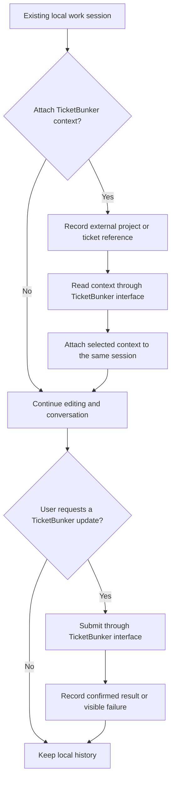

# Tim Session Flow

Related: [[Tim/Tim Overview]] · [[Tim/Tim Data Model]]

## Open and resume

Discover the project from the file or working directory. With `tim -s <name>`,
resolve that folder/repository's named session or create it, then save it as the
default. Plain `tim` resumes that default; `tim filename` edits a file alongside
it. If no default is selected, prompt for a name. Non-Git work uses the working
folder. Canceling the prompt leaves the file open.

Git context is captured automatically. With `--branch` and no name, select the
latest session used on the checked-out Git branch. An explicit name takes
precedence. This optional filter requires an attached branch and never changes
the checkout or binds a session to it.

Acquire exclusive session ownership and launch Pi in that project. Resume the
recorded Pi session explicitly; do not pick the most recent unrelated Pi session.
On first use, create the session and persist the identity returned by Pi. Record
the last-used timestamp after successful open/resume and accepted submissions.

Recover Pi entries plus Tim drafts and source metadata, then rebuild or advance
the file/time index. Use Neovim buffers to render the full session or a file view.

Start with source editing central and a compact session/context pane alongside
it. If Pi is unavailable, local editing and line comments remain usable.

## Review and proposal decisions

Review selects an intent in the shared input, targeting selected code or the
whole current file. Enter submits optional instructions; Cancel review returns
to chat without erasing text. Structured editor tools publish findings/diffs;
Comments and Diffs render them separately from discussion. Green diamonds link
a finding to its proposal. Refresh prepares a new request against current code.

Only explicit Apply changes buffers. Reject only changes proposal status. Undo
reverses an application after checking for newer work. Files stay unsaved until
the user saves. All decisions survive reopening.

## Comments and patch review

Structured editor_comment results create anchored findings; editor_propose_diff
links proposals by stable comment_id. Citations in chat only navigate. A source
marker opens Comments; its green diamond opens Diffs. Old prose findings and
fenced diffs remain supported for session compatibility.

Diffs lists proposals and validates the selected preview against current buffers.
Only Apply mutates buffers, after rechecking every target. Reject makes no edits;
Undo checks current outputs before reversing an application. Stale or unsupported
proposals remain visible without an Apply action. Source saving remains separate.

## Pane and editor lifetime

F4 and the clickable Agent/Hide controls hide or show the agent windows without
closing the session, stopping Pi, or clearing input. Source quit commands in the
launcher exit the entire editor and preserve Neovim's unsaved-file confirmation.
The standalone plugin leaves ordinary Neovim exit behavior unchanged.

## Comment and retrieve context

Selecting a line/range and running `comment` saves a thread with the source
snapshot and Git context. Show a marker beside the source line and open the
thread in the side pane. Saving the comment does not send it to Pi.

When the active source file changes, retrieve exact-file threads from the local
index. Prioritize the current session, matching Git context, and overlapping lines;
other-session/branch history is labelled and expandable. Keep the target source
buffer when the user enters the comment or session pane.

Typing `@` completes project paths. Resolve `@path`, `@path:line`, and
`@[path with spaces]:line` in both user and assistant text. Enter/`gf` follows the
reference; missing/stale locations remain visible as such. Selected ranges retain
structured start/end lines even when displayed as a compatible start-line link.

Asking from a thread fills the input context with the chosen comment and source references.
The user can inspect these attachments before sending. A file-view change does
not silently add source content to an already running Pi turn.

Before send/save, refresh Git context and check the buffer's captured provenance.
Preserve unsaved buffers across external checkout changes. Snapshots retain their
original branch/commit and separately record the current checkout. No branch
binding is required. Detect changes during an operation and mark uncertain provenance rather
than silently attributing work to the new branch. See [[Tim/Tim TicketBunker Compatibility]].

## Ask from a file

```mermaid
sequenceDiagram
    actor User
    participant Tim as Tim in Neovim
    participant Local as Tim local metadata
    participant Pi as Pi RPC and session
    User->>Tim: Select text (persistent highlight, no popup), or choose lines in agent pane
    Tim->>Local: Save draft and source snapshot
    User->>Tim: Type in Message Pi and press Enter (always sends; Save note is separate)
    Tim->>Local: Capture full current buffer and persist submission intent
    Tim->>Pi: prompt with text and explicit references
    Pi-->>Tim: Accepted or rejected response
    alt Accepted
        Pi-->>Tim: Stream message and tool events
        Tim-->>User: Update Chat without changing shared input
        Pi-->>Tim: Structured editor_comment / editor_propose_diff results
        Tim->>Local: Index stable finding and proposal IDs
        Tim-->>User: Update Comments / Diffs and green markers
        Pi-->>Tim: agent_settled
        Tim->>Pi: Read state and persisted entries
        Pi-->>Tim: Entries and active branch
        Tim->>Local: Reconcile entry binding and outcome
        Tim-->>User: Show final outcome and source links
    else Rejected
        Tim->>Local: Retain text and record failure
        Tim-->>User: Show reason and allow correction
    end
```

Acceptance is not completion, and a settled turn may have failed or been
cancelled. Determine the outcome from state and message events. An intermediate
`agent_end` may be followed by retries or compaction; do not use it alone to mark
the user's request finished.

## Reconnect and cancellation

Save before sending. If Pi exits or the connection disappears after send, mark
the outcome uncertain and reconcile persisted entries when resuming. Do not
automatically resend, since an accepted prompt may already have executed tools.
If matching remains ambiguous, present the uncertainty to the user.

Keep drafts separate from the transcript. Serialize submissions initially and
keep pending drafts in Tim. `TimStop` requests Pi cancellation and waits for its
confirmed state. Process death alone does not prove every spawned tool process
has stopped; shutdown behavior needs testing against the pinned Pi release.

## Optional TicketBunker context



Ticket linking, task mutation, and agent activity logging are separate operations.
A link alone never changes ticket status. Ordinary conversation does not imply
that a ticket should be created, completed, or updated.

An unavailable TicketBunker connection leaves the local session usable. Do not
silently retry mutations with an uncertain outcome. Reliable delayed writeback
would require an agreed idempotency and conflict protocol; it is not part of the
first milestone.

## Existing integration evidence

The inspected TicketBunker Pi extension logs session/tool activity. Its launcher
supplies context and extension configuration. Reusing those mechanisms for Tim
requires checking how they behave for a session that is not ticket-bound; that
compatibility has not been established by this design work.

The installed Pi RPC documentation describes streaming, persistent entry access,
and extension dialog requests. Tim must render supported select/confirm/input
dialogs and return the matching response. Pi TUI-only custom widgets need a
separate editor implementation if an extension uses them.

References: [Pi RPC protocol](https://github.com/earendil-works/pi/blob/main/packages/coding-agent/docs/rpc.md),
[Neovim application paths](https://neovim.io/doc/user/starting/#NVIM_APPNAME).

Cancel before prompt dispatch prevents a later send. Cancel after acceptance
requests Pi abort and records cancellation. Retry is always explicit, preserves
selected focus, and uses fresh buffer context. No reconnect automatically retries.
